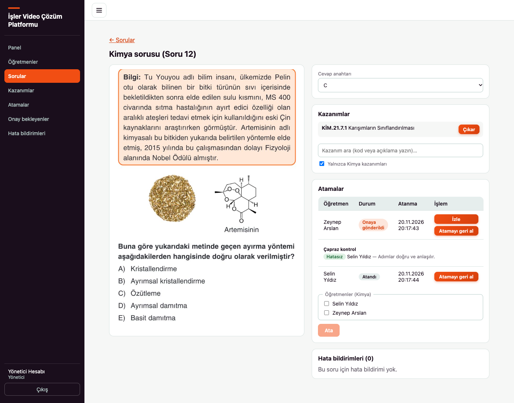
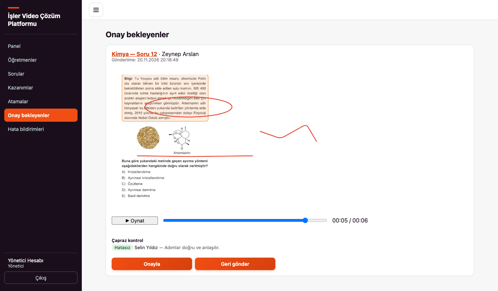
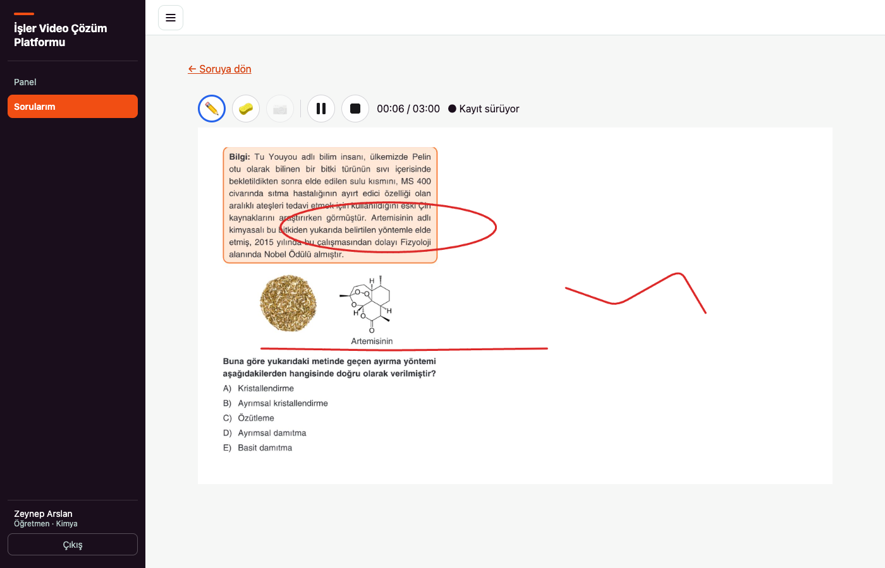
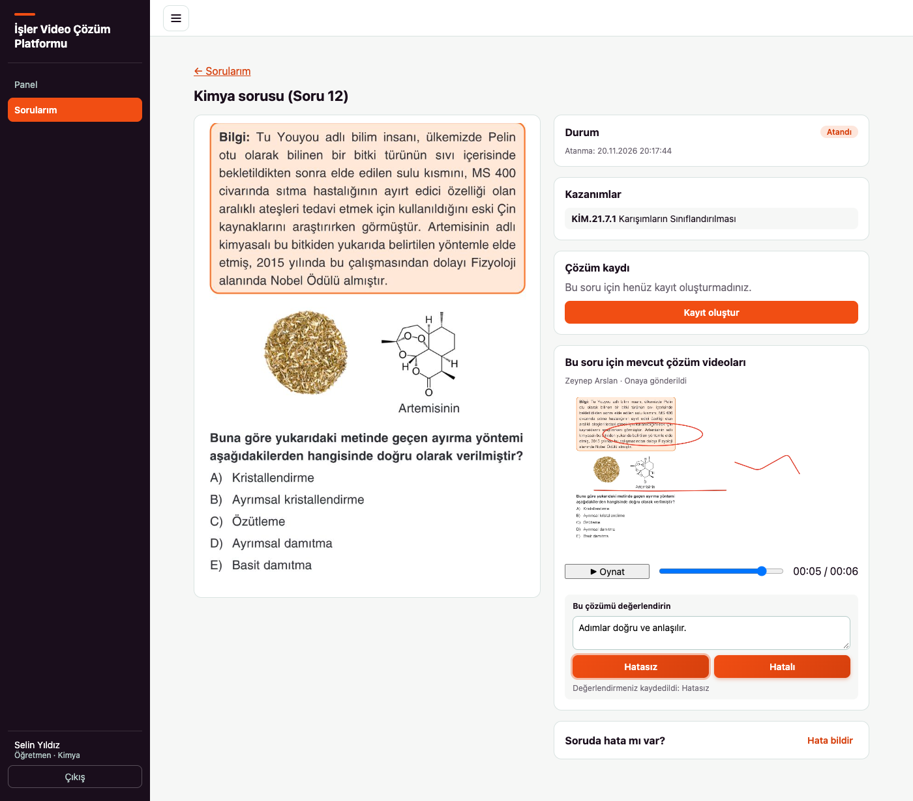
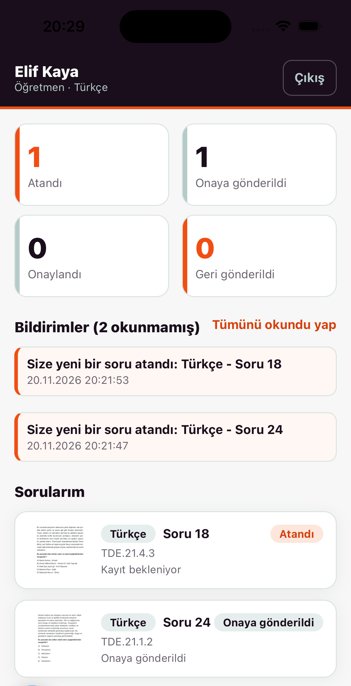
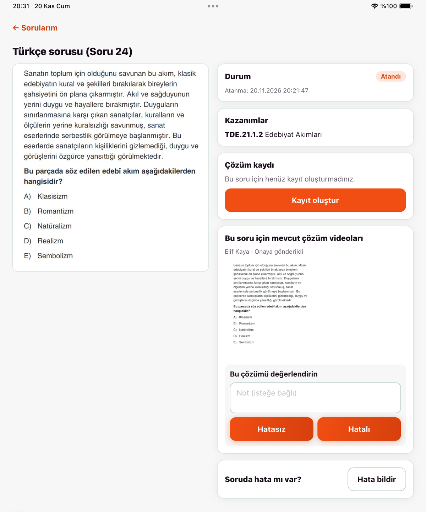

# İşler Video Çözüm Platformu

Öğretmenlerin soru görselleri üzerinde çizerek sesli video çözüm kaydettiği, yöneticinin bu videoları tarayıcıda izleyip onayladığı veya notla geri gönderdiği bir platform. İşler Yayınevi teknik değerlendirme görevi için hazırlandı.

Üç istemci ve bir sunucudan oluşur:

- **Web (React):** yönetici paneli ve öğretmen uygulaması, tek uygulama, role göre ekranlar
- **Mobil ve tablet (React Native, Expo):** öğretmen uygulaması, telefon ve tablet için tek uygulama
- **Sunucu (Node.js, Express):** tek API, MP4 üretimi, e-posta ve push. Veri ve dosyalar Supabase'de

> **Demo videosu:** _(demo çekildikten sonra buraya bağlantı eklenecek)_

| Yönetici: soru, cevap anahtarı, kazanım, atama | Yönetici: onay bekleyen video |
|---|---|
|  |  |

| Web kayıt stüdyosu (canlı çizim) | Öğretmen: mevcut videoyu izleyip çapraz kontrol |
|---|---|
|  |  |

| Telefon: ana sayfa | Tablet: soru sayfası |
|---|---|
|  |  |

## Hazır hesaplar

| Rol | E-posta | Şifre |
|---|---|---|
| **Yönetici** | `admin@example.com` | `Admin12345!` |
| Öğretmen (Türkçe, Matematik, Fizik, Kimya, Biyoloji) | `turkce@`, `matematik@`, `fizik@`, `kimya@`, `biyoloji@` + `example.com` | `Ogretmen12345!` |

Giriş ekranında **Yönetici girişi** ve **Öğretmen girişi** sekmeleri vardır. Herkese açık kayıt formu yoktur; öğretmenleri yönetici oluşturur. Bu hesaplar `npm run db:seed` ile yüklenir.

## Kurulum

**Gereksinimler:** Node.js 22 veya üzeri, npm, ücretsiz bir [Supabase](https://supabase.com) hesabı. Mobil için telefonda **Expo Go** (SDK 58) veya Xcode/Android simülatörü. ffmpeg ayrıca kurulmaz (`ffmpeg-static` ile gelir).

```bash
npm install                          # repo kökünde, dört paketi birden kurar
```

1. **Supabase projesi açın.** *Authentication > Sign In / Providers* altında **"Allow new users to sign up" kapalı** olmalı. *Connect* düğmesinden **Project URL**, **Secret key** (`service_role`) ve **Session pooler** bağlantı adresini (port 5432) not edin.
2. **Sunucu ayarı:** `server/.env.example` dosyasını `server/.env` olarak kopyalayıp `SUPABASE_URL`, `SUPABASE_SECRET_KEY` ve `DATABASE_URL` değerlerini doldurun. E-posta için aşağıdaki bölüme bakın. `.env` repoya girmez.
3. **Veritabanı ve örnek veri:**

```bash
npm run db:migrate -w server         # tabloları oluşturur
npm run db:seed -w server            # 6.411 kazanım, 10 soru (görselleriyle), yönetici ve 5 öğretmen
```

## Çalıştırma

Üç ayrı terminalde:

```bash
npm run dev:server    # API  → http://localhost:4000
npm run dev:web       # Web  → http://localhost:5173
npm run dev:mobile    # Expo (Metro)
```

- **Web:** `http://localhost:5173` adresini açın (Chrome önerilir). Kayıt stüdyosu için tarayıcıdan mikrofon izni verin.
- **Mobil:** Expo açıkken `i` ile iOS simülatörü, `a` ile Android emülatörü açılır veya telefonda Expo Go ile QR kod okutulur. Gerçek cihaz sunucuya `localhost` ile ulaşamaz; bilgisayarın yerel ağ adresini verin (aynı ağda olmalılar):

```bash
EXPO_PUBLIC_API_URL=http://192.168.1.20:4000 npm run dev:mobile
```

Mobilde yalnızca öğretmen girişi vardır; aynı hesapla web ve mobilden girilir. `npm run typecheck` dört paketin tip denetimini yapar.

## Mimari ve temel kararlar

```
shared/   ortak tipler, sabitler ve çizim kodu (web, mobil ve sunucu aynı kodu kullanır)
server/   Express API  ──►  Supabase (Postgres, Auth, Storage)
web/      Vite + React   ─┐
mobile/   Expo + RN       ─┴─► yalnızca Express API ile konuşur
```

| Konu | Karar | Gerekçe |
|---|---|---|
| **Web: tek mi, iki uygulama mı?** | **Tek React uygulaması**, role göre ayrılmış ekranlar | Giriş, oturum, API istemcisi, bildirim ve video bileşenleri iki rolde ortak; iki uygulama bu kodu tekrarlatırdı. Yetki denetimi istemcide değil **sunucudadır**. |
| **Mobil** | Telefon ve tablet için **tek Expo uygulaması**; yalnızca öğretmen girişi | Ekran genişliği 820 px ve üzerindeyse iki sütunlu tablet düzeni kullanılır. Yönetici işleri web panelindedir. |
| **Video üretimi** | İstemci ekranı kaydetmez; **çizim olay günlüğü + mikrofon sesi (+ kamera klibi)** toplar, **sunucu MP4 üretir** | Web ve mobil videoyu aynı sunucu kodu ürettiği için sonuç birebir aynıdır. Çizim canlı video kodlamasına bağlı olmadığından akıcı kalır. Expo Go'da çalışır, native ekran kaydı gerekmez. |
| **Veri ve dosyalar** | **Supabase** (Postgres, Auth, özel Storage). İstemciler Supabase'e değil yalnızca Express API'ye bağlanır | Tek hesapta veritabanı, kimlik doğrulama ve dosya deposu. MP4 üretimi, e-posta ve push için zaten bir sunucu gerekiyor. |
| **Yetki** | Her istekte sunucu jetonu ve kullanıcının hâlâ aktif olduğunu doğrular | Silinen öğretmenin web ve mobildeki oturumu en geç 30 sn içinde otomatik kapanır. Öğretmen yalnızca kendi atamalarını görür; başkasının atamasına 404 döner. |
| **Dosyalar** | Soru görselleri, videolar ve hata ekleri özel bucket'larda; istemciye süreli, imzalı adreslerle verilir | Atanmamış soruya ve başkasının videosuna erişilemez. |
| **Kod düzeni** | **TypeScript**, tek repo (npm workspaces: `shared`, `server`, `web`, `mobile`) | Üç parça aynı veriyi kullanır (çizim olayı, atama durumları, API cevapları); tip tanımı uyumsuzlukları kod çalışmadan yakalar. `shared/` paketindeki çizgi yumuşatma kodu sayesinde ekranda çizilen çizgi ile sunucunun videoya işlediği çizgi aynı koddan çıkar. |
| **Veritabanı erişimi** | Düz SQL (`pg`) ve numaralı migrasyon dosyaları; ORM yok. Supabase Data API kapalı, tüm tablolarda satır düzeyi güvenlik açık ve politikasız. Bağlantı **Session pooler** üzerinden | Web ve mobil tablolara doğrudan erişemez, yalnızca API'den geçer. Session pooler ücretsiz planda IPv4'te çalışır ve `pg` kütüphanesini olduğu gibi kullanmaya izin verir. |
| **Hız** | Erişim jetonu Supabase'in açık anahtarlarıyla sunucuda yerel doğrulanır; soru görselleri sunucu belleğinde önbelleklenir | Her ağ gidiş-dönüşü uzak Supabase'e ~0,3 sn tuttuğu için soru listesi 3,5 sn'den görselleriyle birlikte ~0,4 sn'ye indi. |
| **Yükleme boyutu** | İstemci çizim günlüğünü sıkıştırarak gönderir (koordinatlar 0,1 piksele, zamanlar 1 ms'ye yuvarlanır) | Yoğun çizimli uzun kayıtlarda yükleme sınırı aşılıyordu; tahta 1280×720 olduğundan görsel fark yoktur. |
| **Silme** | Öğretmen silinince hesap kapanır, atama ve kayıtları arşivde kalır. Öğretmen kendi videosunu silerse dosya ve kayıt kalıcı silinir | Yönetici geçmiş kayıtları izleyebilsin. |

### Kullanılan teknolojiler

| Alan | Seçim |
|---|---|
| Web | React 19, Vite, TypeScript |
| Mobil | React Native, Expo SDK 58 (Expo Go), `@shopify/react-native-skia` (çizim), `expo-audio`, `expo-camera`, `expo-video`, `expo-notifications`, `expo-secure-store` |
| Sunucu | Node.js, Express, TypeScript, `pg` (düz SQL, ORM yok), `multer` |
| Veri, kimlik, dosya | Supabase (Postgres, Auth, Storage) |
| Video | `@napi-rs/canvas` (kare çizimi) + `ffmpeg-static` (MP4) |
| E-posta / Push | Nodemailer + Gmail SMTP / Expo Push API |

## Kayıt, çizim ve MP4

1. Öğretmen soruyu açar; soru görseli stüdyoda çizim yüzeyinin arka planıdır. **Kalem ve silgi**, **başlat, duraklat, devam ettir, bitir** ve önizleme vardır. Kamera isteğe bağlıdır.
2. Kayıt sırasında istemci yalnızca nokta ekler: web HTML canvas, mobil Skia kullanır; yumuşatma kodu ortaktır. Böylece çizim işaretçiyi gecikmesiz izler.
3. Kayıt bitince çizim olayları, ses ve varsa kamera klibi sunucuya gider. Sunucu soru görselini arka plan alıp olayları zamanına göre **kare kare çizer** ve ffmpeg ile sesi ekleyerek **tek bir MP4** üretir (1280×720, 15 kare/sn, H.264/AAC, en fazla 3 dk). Ara format yoktur.

- **Silgi** değdiği çizginin tamamını siler; çizgi, silindiği andan sonra videoda görünmez.
- **Duraklatma:** duraklatılan kayıtta kalem ve silgi kullanılabilir; bu çizimler devam anında videoya girer. Duraklatılıp sürdürülen kayıt tek MP4 olur.
- **Kamera** yalnızca öğretmen açtıysa sağ altta küçük bir dikdörtgen olarak videoya girer. Kapalıysa ya da izin verilmediyse kayıt ekran ve sesle tamamlanır. **Mikrofon izni yoksa** kayıt bitirilemez ve anlaşılır bir uyarı gösterilir.
- **Kırpma ve ortadan kesme** sunucuda ffmpeg ile yapılır; her düzenleme "Geri al" ile geri alınabilir. Düzenleme veya yeniden kayıt, onaylanmış ya da onaya gönderilmiş atamayı **Atandı** durumuna döndürür; öğretmen yeniden onaya gönderir.

## Onay ve çapraz atama akışı

Atama durumları: **Atandı → Onaya gönderildi → Onaylandı** ya da **Geri gönderildi** (yönetici notuyla; öğretmen düzeltip yeniden gönderir). Gönderilmeyen video yönetici kuyruğunda görünmez.

- **Çapraz atama:** aynı soru aynı branştan birden çok öğretmene atanabilir (toplu seçimle); her öğretmen kendi kaydını üretir. Öğretmen, aynı sorunun onaya gönderilmiş veya onaylanmış diğer videolarını soru sayfasında izler.
- **Çapraz kontrol:** soruya atanmış öğretmenler birbirinin videosunu **Hatasız / Hatalı** diye işaretler (not isteğe bağlı). Değerlendirmeyi yalnızca yönetici görür, videonun sahibi görmez. Video değişirse o videonun değerlendirmeleri silinir.
- **Atamayı geri alma:** yönetici yanlış atamayı geri alabilir; öğretmene "atama geri alındı" bildirimi, e-postası ve push'u gider.
- **Hata bildirimi:** öğretmen soru için hata türü seçerek (soru metni, şıklar, yazım, kırpma, cevap anahtarı, kazanım, serbest metin) bildirim gönderir; görselde yeri işaretleyebilir, ekran görüntüsü veya en fazla 1 dk video ekleyebilir. Yönetici bildirimi ilgili sorunun üzerinde, gönderen öğretmenin adıyla görür.

## Veri paketi ve yükleme

10 JPEG soru, soru bilgisi ve kazanım listesi `npm run db:seed -w server` ile yüklenir (paket repoda `Örnek sorular/` klasöründedir). Yükleme tekrar çalıştırılabilir; var olan kayıtlara dokunmaz.

| Pakette | Veritabanında |
|---|---|
| `id` | `questions.source_id` |
| `answerKey` | `questions.answer_key` |
| `outcomeKeys` | `question_outcomes` (kazanım koduyla eşleşir) |
| `questionNumber`, `page_num` | `questions.question_number`, `questions.page_num` |
| `<id>.jpg` | Supabase Storage, özel `question-images` bucket'ı |
| *(branş alanı yok)* | Sorunun ilk kazanımının kod ön ekinden belirlenir |
| Kazanım JSON'u (kod → açıklama) | `learning_outcomes` (6.411 kaydın tamamı) |

Kazanım kodu ön eki branşı belirler: `TDE`/`TÜR` Türkçe, `MAT`/`GEO` Matematik, `FİZ` Fizik, `KİM` Kimya, `BİY` Biyoloji; diğer ön ekler (`COG`, `TAR`, `FEL`, `DİN`, `İNG`) branşsızdır. Soru metni ve şıklar pakette olmadığından saklanmaz; hata bildiriminde bu alanlar hata türü seçilerek ve görsel üzerinde yer işaretlenerek belirtilir.

Şema `server/db/migrations/` altındaki numaralı SQL dosyalarıyla yönetilir; tüm tablolarda satır düzeyi güvenlik açıktır ve politika yoktur.

## E-posta

Atama kaydedilir kaydedilmez öğretmene e-posta gider (branş, soru, kazanım kodları ve uygulama bağlantısı). Yönetici öğretmen oluşturunca giriş bilgileri de e-postayla gider. Nodemailer ile **Gmail SMTP** kullanılır:

1. Gönderici Gmail hesabında *2 Adımlı Doğrulama*'yı açın.
2. *Güvenlik > Uygulama şifreleri*nden 16 haneli bir şifre üretin (normal şifreniz değil).
3. `server/.env` içine `SMTP_USER=<gmail adresi>` ve `SMTP_PASS=<uygulama şifresi>` yazın; isteğe bağlı `MAIL_FROM` ve `APP_URL` (e-postadaki bağlantı, varsayılan `http://localhost:5173`).
4. Sunucuyu yeniden başlatın.

Ayar yoksa atama yine yapılır, yalnızca e-posta gitmez. `example.com` adresleri gerçek posta kutusu değildir; e-postayı görmek için yönetici panelinden **kendi adresinizle bir öğretmen oluşturup** ona soru atayın.

## Push

Öğretmen mobil uygulamaya girince Expo push jetonu sunucuya kaydedilir (bir öğretmenin birden çok cihazı olabilir). Atamada sunucu, jetonlara **Expo Push API** ile bildirim gönderir; jeton yoksa (uygulama yüklü değil) sessizce geçilir. Bildirime dokunmak ilgili soruyu açar. Aynı bildirim web ve mobil dashboard'unda da görünür, okununca "okundu" olur. Sunucuda ek ayar gerekmez; mobilde girişte bildirim izni istenir.

**Push yalnızca gerçek cihazda çalışır** (simülatör uzaktan push alamaz); iOS'ta Expo Go için cihazın Expo hesabına bağlı bir proje kimliği gerekebilir.

## Varsayımlar

- Soru ilk atamada da yalnızca **kendi branşındaki** öğretmene atanır; aynı soru aynı öğretmene ikinci kez atanamaz.
- Öğretmene **cevap anahtarı gösterilmez**, kazanımlar gösterilir.
- Çapraz atanan öğretmen yalnızca **onaya gönderilmiş veya onaylanmış** videoları görür; taslak ve geri gönderilmiş videoları görmez.
- Hata bildirimine her türde ek eklenebilir: ekran görüntüsü (en fazla 5 MB) veya en fazla 1 dk video (en fazla 30 MB).
- Geri gönderme notu en fazla 500 karakterdir. Onay ve geri gönderme öğretmene bildirim olarak gider.
- Mobil uygulama yalnızca öğretmenler içindir; yönetici girişi web panelindedir.

## Bilinen sınırlar

- Çıktı, cihaz ekranının birebir kaydı değil, soru görseli ve çizimlerin sunucuda yeniden çizilmesidir. Görev, kayda soru görseli ve çizimlerin girmesini yeterli saydığı için bu yaklaşım seçildi.
- Kayıt bittikten sonra videonun hazırlanması kısa bir işleme süresi alır.
- Gerçek kamera, gerçek cihazda push ve Apple Pencil ile çizim simülatörde denenemedi.
- Yeni soru ekleme ve kazanım ekleme/silme ekranları yoktur; görevde zorunlu olan soru ve kazanım güncelleme (cevap anahtarı, kazanım arama ve ekleme/çıkarma, kazanım açıklaması) vardır.
- Supabase ücretsiz planında dosya başına 50 MB, toplam 1 GB sınırı vardır; videolar bu yüzden en fazla 3 dakikadır. Kullanılmayan ücretsiz projeler bir hafta sonra duraklatılır.
- SMTP ayarı yalnızca Gmail için hazırdır.
